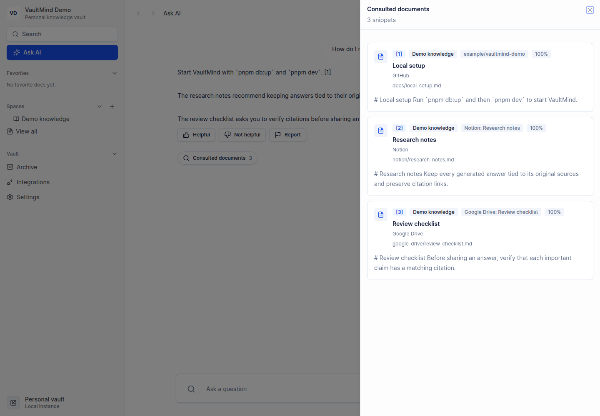

# VaultMind

VaultMind is a self-hosted knowledge vault that answers questions over your own sources and keeps the citations attached. Connect GitHub, Notion, Google Drive, or write documents in the app; VaultMind normalizes them into one searchable RAG index backed by PostgreSQL and pgvector.



## What you get

- one search and chat experience across different source types;
- saved answers with the exact excerpts used as evidence;
- Markdown-aware chunking and idempotent source sync;
- spaces for organizing and scoping retrieval;
- local documents that can join the same index;
- a read-only MCP search tool for local agent clients;
- an optional password lock for the web interface.

The useful part is the trail from answer back to source. VaultMind stores citation order, paths, snippets, and similarity metadata instead of treating the model response as the final record.

## Supported sources

| Source         | What is indexed                                      |
| -------------- | ---------------------------------------------------- |
| GitHub         | Markdown and MDX from public or private repositories |
| Notion         | Pages and databases selected during OAuth            |
| Google Drive   | Selected readable files                              |
| VaultMind docs | Documents written and published inside the app       |

## How it works

```text
GitHub / Notion / Google Drive / VaultMind docs
                       |
                 source adapters
                       |
               normalized documents
                       |
          Markdown chunking + embeddings
                       |
              PostgreSQL + pgvector
                       |
             scoped retrieval + model
                       |
              saved answer + citations
```

Provider-specific code stops at the `SourceDocument` boundary. Chunking, embeddings, retrieval, prompting, and citation persistence are shared by every source.

## Quick start

### Requirements

- Node.js 24
- pnpm 10
- Docker with Compose
- an OpenAI API key for indexing and answering over your own documents

### Install

```bash
pnpm install --frozen-lockfile
cp .env.example .env
```

Set `OPENAI_API_KEY` in `.env`. Then generate a separate key for encrypting stored connector credentials:

```bash
node -e "console.log(require('node:crypto').randomBytes(48).toString('base64url'))"
```

Copy the result to `SOURCE_CREDENTIAL_ENCRYPTION_KEY`. Keep this key stable; existing OAuth credentials cannot be decrypted after it changes.

Start the database and apply the schema:

```bash
pnpm db:up
pnpm db:migrate
pnpm doctor
```

### Try it without external APIs

The demo uses synthetic GitHub, Notion, and Google Drive documents. Embeddings and the saved answer are deterministic, so the seed does not call a connector or model API.

```bash
pnpm demo:seed
pnpm dev
```

`pnpm demo:seed` prints an `askPath`. Open that path on `http://localhost:3000` to inspect a saved answer, then expand **Consulted documents** to see all three sources. Running the seed again resets only the dedicated `VaultMind Demo` data.

### Index your own documents

1. Create a space from the sidebar.
2. Open **Integrations**, choose the space, and connect GitHub, Notion, or Google Drive.
3. Run the first sync and confirm that documents and snippets were created.
4. Open **Ask AI** and ask a question whose answer should exist in those sources.
5. Check **Consulted documents** before relying on the answer.

A good first query crosses source boundaries:

```text
Summarize our data-retention rules and the steps for exporting a backup. Cite each source.
```

You can also create and publish a document inside VaultMind, then enable **Include in Ask AI** to index it.

## Optional access password

Generate a password hash:

```bash
VAULTMIND_ACCESS_PASSWORD='use-a-long-password' pnpm access:hash-password
```

Copy only the generated hash to `VAULTMIND_ACCESS_PASSWORD_HASH` in `.env` and restart the app. This locks the web interface; it does not encrypt PostgreSQL or replace host, disk, and network security.

## Configuration

The full template is [`.env.example`](.env.example). These are the core variables:

| Variable                           | Purpose                                         |
| ---------------------------------- | ----------------------------------------------- |
| `DATABASE_URL`                     | PostgreSQL connection                           |
| `VAULTMIND_BASE_URL`               | Canonical application origin                    |
| `OPENAI_API_KEY`                   | Embeddings and answer generation                |
| `SOURCE_CREDENTIAL_ENCRYPTION_KEY` | Encryption key for stored connector credentials |
| `VAULTMIND_ACCESS_PASSWORD_HASH`   | Optional web-interface lock                     |
| `VAULTMIND_MCP_WORKSPACE_INDEX_ID` | Space exposed by the local MCP server           |

The schema stores 1,536-dimensional vectors. `text-embedding-3-small` is the default embedding model. Changing dimensions requires a schema migration and a full reindex.

GitHub can use `GITHUB_TOKEN` or OAuth. Notion and Google Drive require their OAuth client credentials and callback URLs from `.env.example`.

## Local MCP search

Set `VAULTMIND_MCP_WORKSPACE_INDEX_ID` to an indexed workspace UUID, then inspect or start the read-only stdio server:

```bash
pnpm mcp:tools
pnpm mcp:stdio
```

The MCP server exposes bounded indexed search results with source metadata and short excerpts. See [docs/tech-guides/mcp-local-stdio.md](docs/tech-guides/mcp-local-stdio.md).

## Data and security

VaultMind stores source text, chunks, embeddings, chat history, citations, and encrypted connector credentials in PostgreSQL. A database backup contains the knowledge vault.

Before indexing private material:

- use least-privilege provider credentials;
- keep `.env`, database dumps, traces, and private screenshots out of Git;
- back up the database and connector-encryption key separately;
- use disk encryption on the host;
- put TLS and network controls in front of any remote deployment;
- read [SECURITY.md](SECURITY.md).

The Compose database listens on `127.0.0.1:5433` with development credentials. Do not expose it to another network. `pnpm db:down` stops the container without deleting its volume.

## Development

Fast checks:

```bash
pnpm lint
pnpm typecheck
pnpm test:run
```

Full gate without external credentials:

```bash
pnpm quality
```

With the local database available:

```bash
pnpm quality:db
pnpm e2e
pnpm smoke:local
```

`pnpm smoke:core` adds real GitHub and Notion connector checks when the required credentials and test sources are configured.

## Repository map

```text
src/app/          pages and API routes
src/components/   application UI
src/db/           schema and query helpers
src/lib/rag/      ingestion, retrieval, prompting, and answers
src/lib/sources/  source adapters
scripts/          setup, demo, smoke, and MCP tools
drizzle/          initial database migration
e2e/              Playwright flows
docs/             architecture and implementation notes
```

More detail is available in [docs/architecture.md](docs/architecture.md), [docs/rag-pipeline.md](docs/rag-pipeline.md), and [docs/case-study.md](docs/case-study.md).

## Contributing

Issues and pull requests are welcome. Use synthetic or intentionally public fixtures, keep provider secrets out of tests, and include the validation command you ran. See [CONTRIBUTING.md](CONTRIBUTING.md).

## License

VaultMind is available under the [MIT License](LICENSE). You can use, modify, and distribute it, including in commercial projects, as long as the copyright and license notice are preserved.
